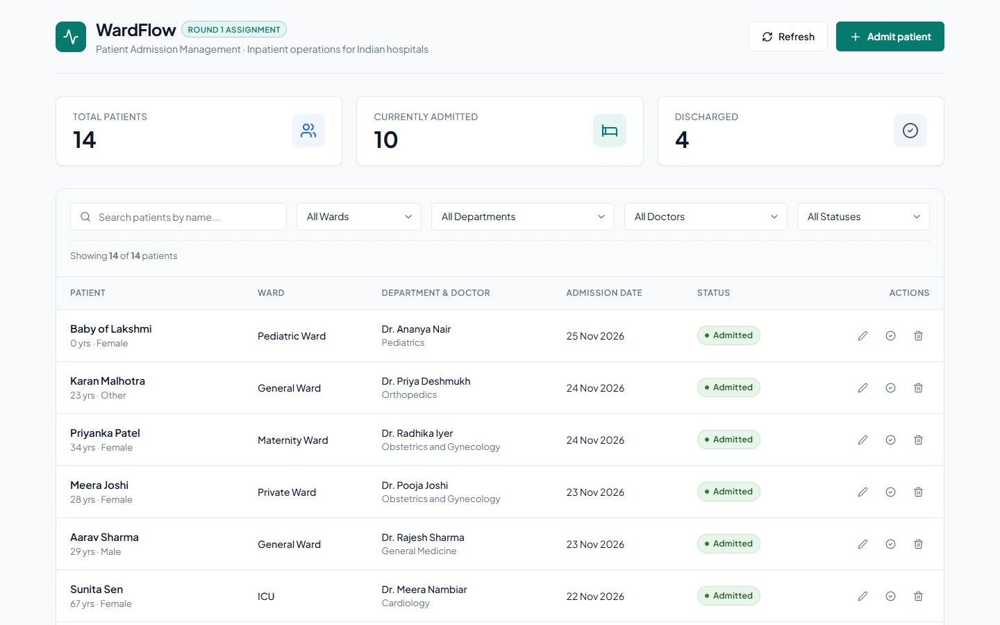
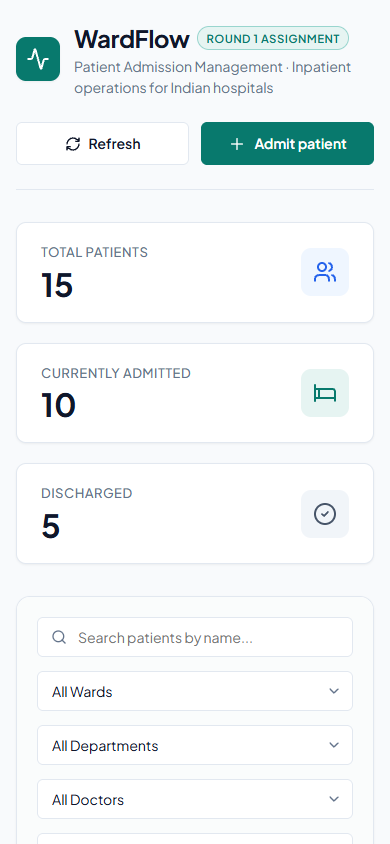
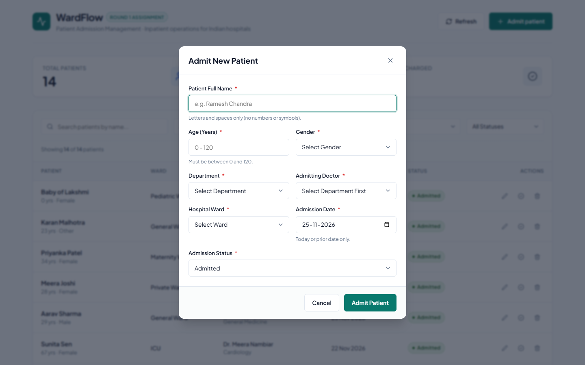
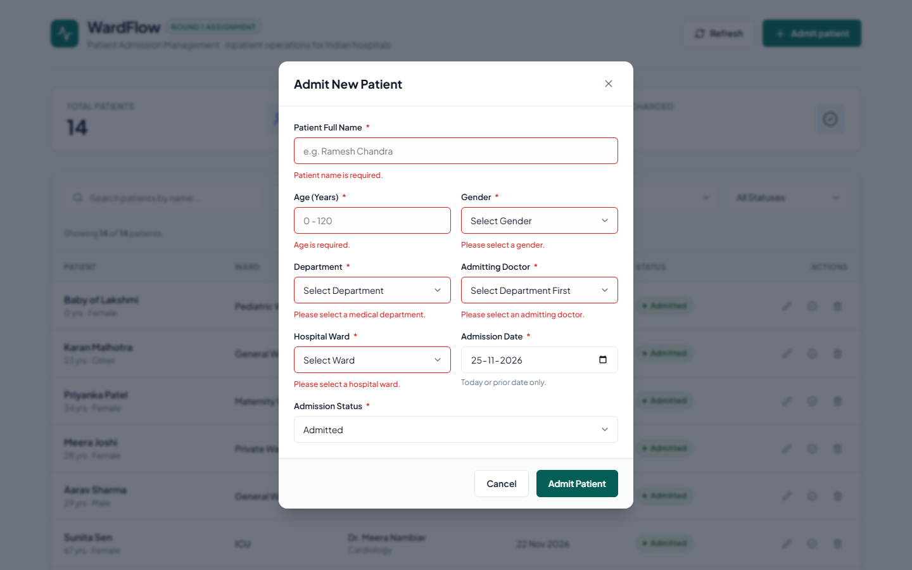
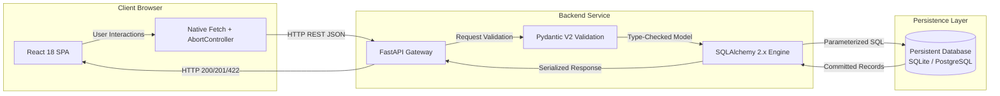

# WardFlow — Patient Admission Management

> **Simplifying inpatient operations.**  
> Built for the **DScribe Software Engineer Intern – Round 1 Task** (Hiring Assignment).

---

## 📸 Application Preview

| Desktop Patient Directory | Mobile Cards View (< 768px) |
|---|---|
|  |  |

| Patient Admission Form | Validation & Boundary Rejection |
|---|---|
|  |  |

---

## 🎯 Executive Summary

WardFlow is a focused, production-grade web application designed for hospital receptionists, ward nurses, and administrative staff managing inpatient admissions. Inspired by DScribe's product philosophy of eliminating paper documentation while keeping hospital workflows fast and intuitive, WardFlow removes unnecessary cognitive overhead and delivers an efficient, reliable, and accessible admission directory.

---

## 🌟 Mandatory Features (100% Implemented & Audited)

1. **Add a Patient**: Responsive modal with 8 required fields, live inline validation, and duplicate submission prevention.
2. **View List of All Patients**: Clear, high-contrast directory rendered as an optimized table on desktop/tablet and structured touch-friendly cards on mobile devices.
3. **Multi-Dimensional Clinical Filtering**: Combined **AND** logic filtering across **Ward**, **Department**, and **Doctor** (with dynamic doctor-department filtering).
4. **Fast Patient Search**: Case-insensitive substring search by patient name with a 250ms debounce and network request cancellation (`AbortController`) to eliminate race conditions.
5. **Edit Patient Records**: Full editing workflow preserving patient ID and creation timestamp while enforcing all validation rules.
6. **Mark as Discharged**: Explicit confirmation dialog; transitions clinical status to `Discharged` while preserving full record history and admission timestamps.
7. **Delete Patient with Confirmation**: Destructive delete requires explicit confirmation with patient name and permanent deletion warning.
8. **Clean Responsive Design**: Tailored experiences for Mobile (360px–480px), Tablet (768px–1024px), and Desktop (1280px+). Zero horizontal scroll or clipped elements.
9. **Live Inpatient Metrics**: 3 compact metric cards (Total Patients, Currently Admitted, Discharged) calculated dynamically via SQL `COUNT` queries directly from the persistent database.

---

## 🛠 Technology Stack (Strict Compliance)

- **Frontend**: **React.js 18.3** with **Vite 5**, JavaScript, Lucide React icons, Native Fetch API, Custom Accessible CSS. *(Zero third-party CSS bloat or heavy UI component libraries).*
- **Backend**: **Python 3.13**, **FastAPI 0.115**, **Pydantic V2**, **SQLAlchemy 2.x**, **Uvicorn**, **Psycopg 3**. *(Strictly NO Node.js used on the backend).*
- **Database**:
  - **Local Development**: Persistent SQLite (`patients.db`) with disk storage surviving process restarts.
  - **Production Deployment**: Hosted **PostgreSQL (Neon)** with TLS encryption and connection pooling.
- **Testing**: **Pytest** with 22 automated integration tests covering boundary conditions, validation rejections, CRUD workflows, and connection restart persistence.

---

## 📐 Architecture & Data Flow



---

## 🛡 Rigorous Validation Rules (Frontend & Backend Mirrored)

| Field | Rule | Frontend Behavior | Backend Behavior |
|---|---|---|---|
| **Name** | Required, letters and spaces only (1–100 chars). No numbers, punctuation, or whitespace-only names. | Regex check; red error text below input. | Pydantic regex validator; returns HTTP 422 with field-specific detail. |
| **Age** | Required whole integer between **0** and **120** inclusive. | Rejects negative, >120, decimals, or text. | Custom validator rejects boolean (`True`/`False`), floats, strings, or values < 0 or > 120. |
| **Gender** | Required from approved list: `Male`, `Female`, `Other`, `Prefer not to say`. | Native select dropdown. | Enforced against `GENDERS` constant. |
| **Ward** | Required from approved list (General, Private, ICU, Surgical, Pediatric, Maternity). | Native select dropdown. | Enforced against `WARDS` constant. |
| **Department** | Required from approved clinical list. | Changing department auto-resets incompatible doctor. | Enforced against `DEPARTMENTS` constant. |
| **Doctor** | Required from approved staff list. Must practice in the selected department. | Dynamically filtered dropdown based on department. | Cross-field `@model_validator` verifies doctor-department relationship. |
| **Admission Date** | Required date. **Cannot be a future date**. | `max={today}` on HTML5 date picker; comparison check. | Compares against `Asia/Kolkata` local hospital date; rejects future dates. |
| **Status** | Required: `Admitted` or `Discharged`. Default: `Admitted`. | Native select dropdown. | Database CHECK constraint + Pydantic validation. |

---

## 🚀 Local Setup Instructions

### Prerequisites
- Python 3.10+ (Tested on Python 3.13)
- Node.js 18+ (Tested on Node v24)
- Git

### 1. Clone the Repository
```bash
git clone https://github.com/<your-username>/wardflow-patient-management.git
cd wardflow-patient-management
```

### 2. Backend Setup
```bash
cd backend

# Create virtual environment
python -m venv venv

# Activate virtual environment
# Windows PowerShell:
.\venv\Scripts\Activate.ps1
# macOS/Linux:
# source venv/bin/activate

# Install dependencies
pip install -r requirements.txt

# Start FastAPI development server
uvicorn app.main:app --host 127.0.0.1 --port 8000 --reload
```
The backend API is now running at `http://127.0.0.1:8000`.  
Interactive Swagger documentation is available at `http://127.0.0.1:8000/docs`.

### 3. Frontend Setup
In a new terminal:
```bash
cd frontend

# Install dependencies
npm install

# Start Vite development server
npm run dev
```
Open your browser at `http://localhost:5173`. The application is fully connected and ready to use!

---

## 🧪 Running Tests

### Backend Unit & Integration Tests (22 Tests)
```bash
cd backend
.\venv\Scripts\pytest -v
```
All 22 automated tests verify:
- Boundary conditions (Age 0 for newborns, Age 120 for centenarians)
- Rejection of negative ages, boolean ages, future admission dates, invalid wards, and doctor-department mismatches
- Multi-dimensional search and combined filters (AND logic)
- Edit, discharge, idempotent discharge, and delete workflows
- Database persistence surviving complete connection teardown

---

## 📡 REST API Reference

| Method | Endpoint | Description | Status Code |
|---|---|---|---|
| `GET` | `/api/health` | Health check verifying database connectivity | 200 |
| `GET` | `/api/options` | Master dropdown options (wards, departments, doctors, statuses) | 200 |
| `GET` | `/api/stats` | Dynamic database counts (total, admitted, discharged) | 200 |
| `GET` | `/api/patients` | List patients (supports `search`, `ward`, `department`, `doctor`, `status`) | 200 |
| `GET` | `/api/patients/{id}` | Retrieve single patient by ID | 200 / 404 |
| `POST` | `/api/patients` | Admit new patient (enforces all validations) | 201 / 422 |
| `PUT` | `/api/patients/{id}` | Update existing patient record | 200 / 404 / 422 |
| `PATCH` | `/api/patients/{id}/discharge` | Mark patient as Discharged (idempotent) | 200 / 404 |
| `DELETE` | `/api/patients/{id}` | Permanently delete patient record | 200 / 404 |
| `POST` | `/api/seed` | Populate 14 demonstration records (safe & idempotent) | 200 |

---

## 🔒 Security, Privacy & Demo Notice

- **Fictional Data Only**: All patient names, ages, diagnoses, and doctor assignments in this repository are 100% fictional demonstration records.
- **No Production Medical Use**: This software was developed solely as a technical hiring assessment. It is not intended for real-world clinical use. A production hospital deployment would require HIPAA/ABDM/DPDP compliance, role-based access control (RBAC), multi-factor authentication, audit logging, and encrypted backups.
- **Zero Secrets Committed**: No database connection strings, passwords, or secret keys are present in Git. All credentials are parameterized via environment variables.

---

## 👥 Round 2 Interview Defense Guide

Looking for file-by-file explanations, common interviewer questions, and step-by-step code modification exercises?  
Refer to [docs/ROUND2_GUIDE.md](docs/ROUND2_GUIDE.md).
