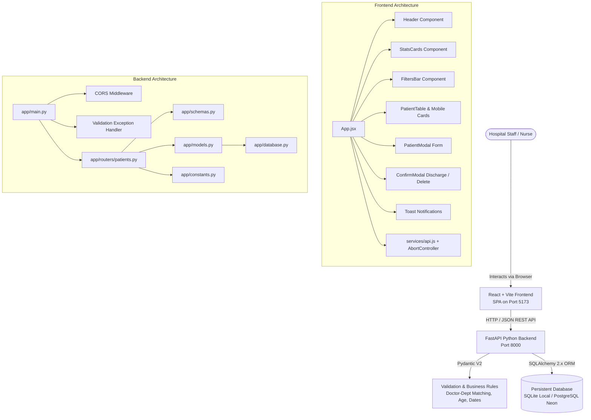

# WardFlow Architecture

## System Overview

WardFlow is an inpatient admission management web application designed for hospital administrative staff and nurses. It simplifies tracking admitted patients, editing admission details, filtering by clinical dimensions, discharging patients, and permanently deleting erroneous records.

## Architectural Highlights

### 1. Dual-Layer Validation
Validation is mirrored between React and FastAPI:
- **Client-side validation** gives instantaneous inline feedback to the user before network transmission.
- **Server-side validation** acts as the authoritative gatekeeper, verifying regex, data types, value boundaries, doctor-department mapping, and date sanity.

### 2. Search Race Condition Prevention
To prevent slow network responses from overwriting newer search results, the frontend utilizes `AbortController` in `services/api.js`. Each new keystroke in the debounced search aborts the in-flight request and dispatches a fresh request.

### 3. Dynamic Clinical Hierarchy
Doctor selections are dynamically filtered by the chosen Department on both the frontend and backend. Changing a department resets any previously chosen doctor that does not practice in that department.

### 4. Database Persistence
Records are committed to a persistent database engine (SQLite file locally, PostgreSQL on hosted cloud). The database schema includes Check Constraints (`age >= 0 AND age <= 120`, `status IN ('Admitted', 'Discharged')`) to guarantee relational integrity.
